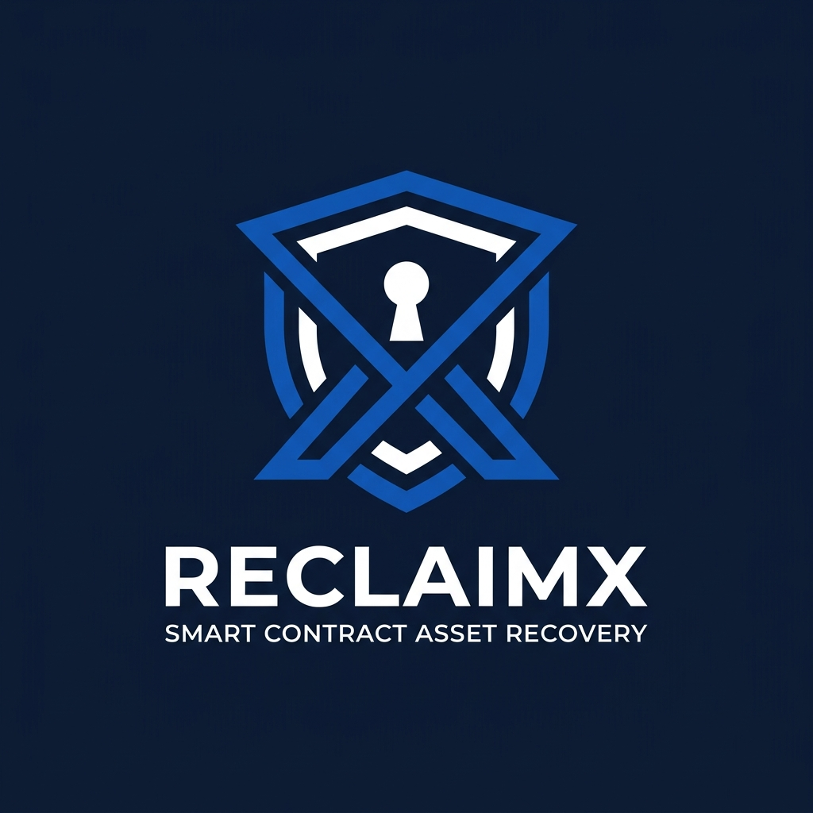

<div align="center">
  

  # ReclaimX — Smart Contract Discovery & Recovery on BOT Chain

  **Find your contracts. Discover your funds. Reclaim what’s recoverable.**

  [](./WHITEPAPER.md)
  [](https://opensource.org/licenses/MIT)
  [-0284c7?style=flat-square)](https://scan.botchain.ai)
  [](https://scan.botchain.ai/address/0x7fedd4981cf2448366c3de1099b43823d4deac13)

</div>

ReclaimX is a non-custodial smart contract discovery and asset recovery protocol engineered specifically for **BOT Chain** (BOT Chain Mainnet Chain ID `677` / Bohr Testnet Chain ID `968`). It enables developers, campaign managers, and Web3 users to index contracts they deployed, inspect active bytecode, resolve EIP-1967/EIP-1822 proxies, review native BOT and ERC-20 balances, simulate withdrawal methods via pre-flight call dry-runs (`eth_call`), decode custom errors and campaign timelocks, and execute direct recoveries from their connected wallet.

📖 **For detailed protocol mechanics, security invariants, and empirical case studies, read the [Official ReclaimX Whitepaper](./WHITEPAPER.md).**

---

## Live Deployed Smart Contract (BOT Chain Mainnet)

* **Contract Address:** [`0x7feDd4981CF2448366c3de1099B43823D4Deac13`](https://scan.botchain.ai/address/0x7fedd4981cf2448366c3de1099b43823d4deac13)
* **Deployment Transaction:** [`0x3c359c7a76ef9968d47f73bab094715d9ca0b435c6df61a7d62fa1bfb9f86678`](https://scan.botchain.ai/tx/0x3c359c7a76ef9968d47f73bab094715d9ca0b435c6df61a7d62fa1bfb9f86678)
* **Network:** BOT Chain Mainnet (Chain ID `677`)
* **Native Token:** `BOT`
* **RPC Endpoint:** `https://rpc.botchain.ai`
* **Block Explorer:** [https://scan.botchain.ai](https://scan.botchain.ai)
* **Contract Verification:** **Pass - Verified** on BOTScan
* **Initial Deep Scan Price:** `0.05 BOT`

---

## 1. Technology Stack

* **Frontend:** Next.js App Router (TypeScript, React 19)
* **Styling:** Tailwind CSS with a clean, high-clarity **White and Blue** enterprise design system (no glossy glassmorphism, no rainbow gradients)
* **Web3 Integration:** Wagmi 2.x, Viem 2.x, `@reown/appkit`, `@reown/appkit-adapter-wagmi`, `@tanstack/react-query`
* **Smart Contracts:** Solidity `^0.8.20`, OpenZeppelin Contracts 5.x (`Ownable2Step`, `Pausable`, `ReentrancyGuard`)
* **Testing & Scripting:** Foundry (`forge`, `cast`), Node.js native test runner (`node --test`, `tsx`)

---

## 2. Core Security & Non-Custodial Architecture

1. **Non-Custodial Design:**
   * The platform contract (`contracts/ContractRecoveryHub.sol`) does **NOT** custody user assets and cannot execute arbitrary calls on users' behalf.
   * It serves solely as an on-chain registration registry, event emitter, and payment collection hub for paid Deep Scans.
   * All asset recoveries happen **directly** between the user's wallet and their target contract. Recovered assets are sent directly to the caller's wallet or the contract's defined egress recipient.

2. **Server-Side Independent Verification (Zero Trust Client Model):**
   * Never trusts client-submitted transaction hashes or claimed scan IDs.
   * The backend independently connects to the BOT Chain RPC node, validates the transaction receipt status (`status == 1`), verifies the `ScanRequested` event was emitted by our authentic deployed `ContractRecoveryHub` contract, checks that the user matches the connected wallet, verifies exact payment against on-chain contract state, and enforces deduplication to prevent replay attacks.

3. **Conservative Recovery Engine:**
   * Checks bytecode presence (filters self-destructed or non-contract addresses).
   * Reads EIP-1967 Implementation Slot (`0x3608...`), Admin Slot (`0xb531...`), and EIP-1822 UUPS Slot (`0xc5f1...`).
   * Dry-runs candidate withdrawal methods (`withdraw()`, `withdrawAll()`, `claim()`, `emergencyWithdraw()`, etc.) via node simulation (`eth_call`).
   * Categorizes contracts into 3 clear statuses:
     * `Potentially Recoverable`: Active bytecode, balance > 0, caller authorized, simulation succeeds with 0 errors.
     * `Requires Manual Review`: Active bytecode, balance > 0, but proxy upgrade required, complex arguments needed, or simulation reverted.
     * `No Supported Recovery Path Found`: Zero balance or no recognized withdrawal selectors.

---

## 3. Automated Tests & Results

The repository includes both comprehensive Solidity Foundry tests (unit + fuzzing) and backend integration tests.

### Run All Tests
```bash
npm test
```

### Foundry Contract Test Suite (`npm run test:sol`)
```
Ran 18 tests for test/ContractRecoveryHub.t.sol:ContractRecoveryHubTest
[PASS] testFuzz_DeepScan_ExactPrice(uint96) (runs: 256)
[PASS] test_GetScanRequest_NonExistent()
[PASS] test_InitialState()
[PASS] test_Pause_RevertUnauthorized()
[PASS] test_Pause_Unpause_Controls()
[PASS] test_RequestDeepScan_ExactPayment_Success()
[PASS] test_RequestDeepScan_RevertOnOverpayment()
[PASS] test_RequestDeepScan_RevertOnUnderpayment()
[PASS] test_RequestDeepScan_RevertOnZeroPayment()
[PASS] test_RequestFreeScan_Success()
[PASS] test_ScanId_Uniqueness()
[PASS] test_SetDeepScanPrice_ByOwner()
[PASS] test_SetDeepScanPrice_RevertUnauthorized()
[PASS] test_WithdrawRevenue_RevertOnFailedTransfer()
[PASS] test_WithdrawRevenue_RevertOnZeroAddress()
[PASS] test_WithdrawRevenue_RevertOnZeroBalance()
[PASS] test_WithdrawRevenue_RevertUnauthorized()
[PASS] test_WithdrawRevenue_Success()
Suite result: ok. 18 passed; 0 failed; 0 skipped
```

### Backend Security Test Suite (`npm run test:backend`)
```
▶ ReclaimX Backend Security & Processing Tests
  ✔ Prevents replay attacks by deduplicating transaction hashes
  ✔ Enforces per-wallet rate limiting
  ✔ Binds scan records strictly to the authentic caller wallet
  ✔ Conservative analysis marks non-contract / self-destructed address as NO_PATH_FOUND
  ✔ Zero balance contracts are safely marked as NO_PATH_FOUND
  ✔ Contracts with funds and proxy architecture require manual review if standard calls fail
✔ ReclaimX Backend Security & Processing Tests (6 passed; 0 failed)
```

---

## 4. Local Development Instructions

### Prerequisites
* Node.js v20+
* Foundry (`forge` and `cast`) installed (`curl -L https://foundry.paradigm.xyz | bash`)

### 1. Install Dependencies
```bash
npm install
```

### 2. Environment Configuration
Copy `.env.example` to `.env.local` and configure your credentials:
```bash
cp .env.example .env.local
```

In `.env.local`:
```ini
# Reown Project ID (loaded securely server-side)
REOWN_PROJECT_ID=your_reown_project_id

# BOT Chain Network Configuration
NEXT_PUBLIC_CHAIN_ID=968
NEXT_PUBLIC_CHAIN_ID=677
NEXT_PUBLIC_RPC_URL=https://rpc.botchain.ai
NEXT_PUBLIC_CHAIN_NAME="BOT Chain Mainnet"
NEXT_PUBLIC_NATIVE_CURRENCY_SYMBOL=BOT
NEXT_PUBLIC_EXPLORER_URL=https://scan.botchain.ai
NEXT_PUBLIC_EXPLORER_API_URL=https://scan.botchain.ai/api

# Deployed Contract Address
NEXT_PUBLIC_CONTRACT_RECOVERY_HUB_ADDRESS=0x7feDd4981CF2448366c3de1099B43823D4Deac13

# Deployer Private Key (For foundry deploy scripts only)
DEPLOYER_PRIVATE_KEY=your_private_key_here
```

### 3. Run Development Server
```bash
npm run dev
```
Open [http://localhost:3000](http://localhost:3000) to view ReclaimX.

---

## 5. Deploying to BOT Chain Testnet

To deploy a new instance of `ContractRecoveryHub` to Bohr Testnet:

```bash
# Make sure DEPLOYER_PRIVATE_KEY is set in .env.local
npm run deploy:testnet
```

Or via direct Forge script command:
```bash
source .env.local && forge script script/DeployHub.s.sol:DeployHubScript \
  --rpc-url https://rpc.bohr.life \
  --broadcast -vvv
```

Update `NEXT_PUBLIC_CONTRACT_RECOVERY_HUB_ADDRESS` in `.env.local` with the new address printed by the deployer script.

---

## 6. Verifying the Contract on the Explorer

### Option A: Via Command Line (Recommended)
Run the automated verification script:
```bash
npm run verify
```

Or run the direct Foundry verification command:
```bash
forge verify-contract 0x7feDd4981CF2448366c3de1099B43823D4Deac13 \
  contracts/ContractRecoveryHub.sol:ContractRecoveryHub \
  --verifier blockscout \
  --verifier-url https://scan.botchain.ai/api \
  --compiler-version v0.8.20+commit.a1b79de6 \
  --constructor-args 00000000000000000000000055da37abbf8c9141ada4dd1c2ef7211c0483ec1600000000000000000000000000000000000000000000000000b1a2bc2ec50000 \
  --watch
```

### Option B: Via BohrScan Web UI
If BohrScan requires account login:
1. Go to: [`https://scan.bohr.life/address/0x8baf11bb2f5c35d81fd21cd40eae0c205113cba1/contract_verifications/new`](https://scan.bohr.life/address/0x8baf11bb2f5c35d81fd21cd40eae0c205113cba1/contract_verifications/new)
2. Select **Solidity (Single file)** or **Solidity (Standard-Json-Input)**.
3. Upload `contracts/ContractRecoveryHubFlat.sol` or `standard_json_input.json`.
4. Set Compiler: `v0.8.20+commit.a1b79de6`.
5. Constructor Arguments:
   ```
   000000000000000000000000f39fd6e51aad88f6f4ce6ab8827279cfffb9226600000000000000000000000000000000000000000000000000b1a2bc2ec50000
   ```

---

## 7. Mainnet Deployment Checklist

Before deploying ReclaimX to BOT Chain Mainnet (`Chain ID: 677`):

- [ ] **Multi-Sig Ownership:** Transfer ownership of `ContractRecoveryHub` to a multisig or governance vault using `transferOwnership(address)` and `acceptOwnership()` (`Ownable2Step`).
- [ ] **Configure Mainnet Environment:**
  - `NEXT_PUBLIC_CHAIN_ID=677`
  - `NEXT_PUBLIC_RPC_URL=https://rpc.botchain.ai`
  - `NEXT_PUBLIC_CHAIN_NAME="BOT Chain"`
  - `NEXT_PUBLIC_EXPLORER_URL=https://scan.botchain.ai`
  - `NEXT_PUBLIC_EXPLORER_API_URL=https://scan.botchain.ai/api`
- [ ] **Mainnet Pricing:** Set initial `deepScanPrice` in accordance with BOT token market valuation using `setDeepScanPrice(uint256)`.
- [ ] **Audit & Cold Test:** Run `npm test` against mainnet fork to confirm all gas estimations and RPC limits.
- [ ] **DDoS & Rate Limiting:** In production cluster deployments, configure Redis-backed rate limiting for `/api/scan` to complement in-memory rate limiting.

---

## 8. Known Limitations & Technical Accuracy

1. **Discovery Completeness:**
   * Automated discovery indexes direct contract deployment transactions and factory deployments surfaced via internal transactions from the explorer API (`txlist` and `txlistinternal`).
   * Deeply obfuscated multi-hop factory deployments that do not emit standard creation traces on Blockscout can be inspected directly by entering their address into the URL (`/contract/<address>`).

2. **Simulation Diagnostics vs. Execution:**
   * Pre-flight simulation (`eth_call`) confirms whether a call would succeed at the current block state.
   * If contract state changes between simulation and execution (e.g. paused state, timelock, balance spent by another transaction), the transaction may revert. ReclaimX presents call parameters transparently so users retain full visibility.
